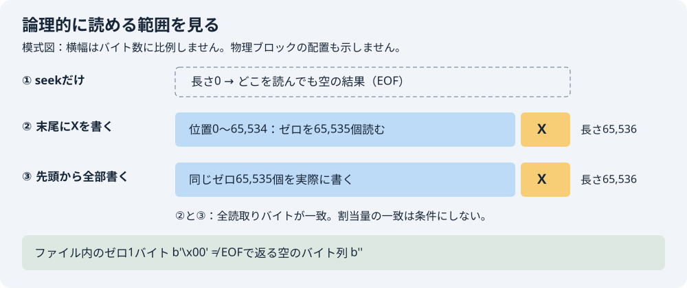

# ストレージ・ファイルシステム工学：疎なファイルの論理長と割当量

「末尾に1バイトを書いたのに、65,536バイト読めるのはなぜか」を、自分のMacで確かめる教材です。[操作画面](index.html)は保存した実測値を段階的に表示します。[図だけを見る](file-layout.svg)こともできます。

扱うのは、ファイル位置・論理長・読み出す内容・OSが報告する割当量の区別です。分野全体の完成ではありません。

## 1. 先に予想する

空のファイルで位置を65,535に移します。まだ何も書いていません。

- ファイルの長さは0、65,535、65,536のどれでしょうか。
- ここで先頭を1バイト読むと、ゼロの1バイトと空の結果のどちらになるでしょうか。
- この位置にXを1バイト書くと、先頭から何バイト読めるでしょうか。
- 同じ内容を先頭から全部書いたファイルと、割当量も必ず等しくなるでしょうか。

先に自分の言葉で理由を残してください。「観測値を見る」で保存された結果を開き、正常な対照と比べます。原典・実装を読んだ後、「観測から答えを確認する」で解釈を開きます。条件を切り替えると予想欄をリセットし、予想の編集でも古い結果・生データ・答えを消します。「最初からやり直す」はseekのみの初期状態へ戻します。

## 2. 操作する

このフォルダーで実行します。Python標準ライブラリだけを使います。

~~~sh
python3 -B experiment.py > run-local.json
python3 -B verify.py run-local.json
~~~

新しく作る一時フォルダーの中で、最大64 KiBのファイルを2個だけ扱い、終了時に削除します。外部ファイルのパス、可変サイズ、ネットワーク、Dockerは使いません。run-local.json は自分の再実行結果です。配布済みの [observations/run.json](observations/run.json) は上書きしないでください。

画面だけを使う場合は、このフォルダーで次を実行し、表示された127.0.0.1のURLを開きます。port 0は空きportを選び、終了時はCtrl+Cで自分のserverを停止します。今回のGUI検査もloopback HTTPで行いました。

~~~sh
python3 -m http.server 0 --bind 127.0.0.1
~~~

画面は保存観測の再生で、新しくOS実験を実行する機能はありません。初回の実ブラウザ検査5項目は[旧原票](../browser-qa/run-2026-10-06T022404940Z/report.json)へ保存しています。現在の改修版の検査と受入は[status](observations/status.json)へ別に記録します。

readerは最初に静的な`observations/data.js`を読み、元run.jsonをJSONとして解釈して再直列化した内容のSHA-256を照合します。これは元ファイルのバイト列SHAとは別の値です。data.jsとrun.jsonの全データ一致は保存検査でも確認します。欠落・改変なら観測表示を止め、OS実験の失敗とは区別します。ボタンごとの非同期取得はなく、資料を直した後はページを再読込みします。

## 3. 操作の欠けた例と正常な対照を比べる

2026年10月6日 11:06:40 JSTのMac実測（Darwin 25.1.0、arm64、Python 3.9.6）です。

| 操作 | 論理長 st_size | 先頭から読める内容 | st_blocks | OS報告値を512倍 |
|---|---:|---|---:|---:|
| 書込みを省略：seekだけ | 0バイト | 空の結果 <code>b''</code> | 0 | 0バイト |
| 位置65,535でXを1バイト書く | 65,536バイト | 65,535個のゼロと末尾のX | 8 | 4,096バイト |
| 先頭から同じ内容を全て書く | 65,536バイト | 同上。全バイト一致 | 128 | 65,536バイト |

seekだけの例では「書込みを忘れたため、意図した内容を作れていない」ことを観測します。システムコールが失敗した例ではありません。書込み後のファイルでも、位置65,536から読むとEOFなので空の結果です。ファイル内の未書込み部分を読むゼロバイトと区別してください。

割当量は書込み後・close前、fsyncなしの観測時点の値です。ファイルシステムの種類は調査しておらず、OS名からAPFSと断定していません。別環境で両者の割当量が同じでも、この教材の期待値には違反しません。

## 4. 原典と実装をたどる

- [Appleのlseek(2)資料](https://developer.apple.com/library/archive/documentation/System/Conceptual/ManPages_iPhoneOS/man2/lseek.2.html)のDESCRIPTIONは、EOFを越えて位置を移動でき、後から書き込むと間の読取りがゼロになることを説明しています。古いアーカイブ資料なので、今回のMac実測と併せて読みます。
- [Pythonのpread](https://docs.python.org/3/library/os.html#os.pread)は、位置を指定して読み、通常のファイル位置を動かさない操作です。EOFでは空のバイト列を返します。
- [Pythonのstat_result.st_blocks](https://docs.python.org/3/library/os.html#os.stat_result.st_blocks)は、割り当てられた512バイト単位のブロック数です。論理長と同じ量を表すとは限りません。
- [実験コード](experiment.py)のcollectは、seekのみ→末尾1バイト書込み→全内容の通常書込みの順にOSを呼びます。written_recordが内容とOS報告値を保存します。
- [固定期待値](expected.json)は実行前に作成しました。[検証器](verify.py)は実験コードをインポートせず、保存された全読取りバイトを解凍して固定期待値と比較します。

## 5. 答え合わせ

seekは次の読書き位置を変えます。今回、長さは0のままでした。位置65,535で1バイトを書くと、読める範囲は位置0〜65,535になり、長さは65,536です。先に書いていなかった位置0〜65,534はゼロとして読めました。

保存した読取り内容は両方式で全バイト一致しました。st_blocksの差は今回のOS報告値として確認できましたが、内容が同じなら割当量も同じだ、という判断はできません。逆に差が出なくても、seekやゼロ読取りの挙動が誤っているとは判断できません。

[保存観測](observations/run.json)には全読取り内容をzlibとBase64で可逆圧縮して収めています。表示用に作った架空のバイト列ではありません。[検証結果](observations/verification.json)は37項目成功。実OS実験は1回、再試行0回、一時ファイル削除を確認しました。実験本体の所要時間は0.002803秒ですが、性能比較の測定値として使いません。

## 6. 判断できないことと次の学習

実デバイスへの物理的な配置や予約、圧縮・重複排除の内部動作、速度、電源断後の永続性は実証していません。SEEK_HOLE・SEEK_DATA、巨大ファイル、コピー時の穴の保存、Windows、Linux/Docker実行も未検証です。通常書込みの対照も、物理的に隙間なく保存されたと断定しません。

元coverageにはhardlink/unlink/open FD・replace時metadataなどが残りますが、別分野や既存受入の重複を照合してから課題を選びます。今回は新教材を増やさず、この保存済み疎ファイル教材の局所修理と独立受入を進めます。[対応範囲表](COVERAGE.md)と[再利用用Skill](SKILL.md)を参照してください。Atlasの入口・検索への統合は未完了です。

初回の実ブラウザ画像は4枚あり、調整担当が目視確認しました。[旧目視記録](../browser-qa/visual-review.json)と[旧1280px画像](../browser-qa/run-2026-10-06T022404940Z/storage-desktop-full.png)、[旧390px画像](../browser-qa/run-2026-10-06T022404940Z/storage-mobile-full.png)を履歴として保持しています。これらは過去版で、初回の検証状態の文面更新より前に撮影しました。制作時の37検証原票にある「実ブラウザ未実施」も、その時点の状態です。

## 7. 現画面の局所修理とGUI検査

予想を書き換えても旧答えが残る点を修理し、明示resetと、原典の後で解釈を開く操作を追加しました。保存データの初回digest照合を待つ間は表示を止め、欠落・形式不正・改変をOS実験の失敗と区別します。OS原票・expected・experiment・元verifier・初回共有GUI証拠は変更していません。

[現GUI原票](browser-qa/run-2026-10-06T072414863Z/report.json)は3条件について15検査pass、42実ポインター操作・11文字入力・選択APIによる条件変更6回を記録しています。1280/390pxで保存raw・比較表を元原票と照合し、予想編集・reset・初回digest待ち中の変更と復帰、欠落/形式不正/改変後のページ再読込による回復を確認しました。静的データを最初に1回読む構成のため、ボタンごとのfetch競合とは区別しています。

nativeメニューへのキー操作は2回とも選択値が変わらず、harnessが途中停止しました。[初回](browser-qa/run-2026-10-06T072116311Z/report.json)と[2回目](browser-qa/run-2026-10-06T072216960Z/report.json)を成功へ書き換えず保持しました。最後の検査では選択メニューのみPlaywrightのselectOption APIを使い、その6回を実ポインター・文字入力へ含めていません。native dropdownの手操作は未確認で、UI全操作が実ポインターで通ったとは主張しません。

[現画面7画像の目視記録](browser-qa/visual-review.json)と[最終binding](browser-qa/gui-revision-20261006T071437683122Z/final-binding.json)に、修正前snapshot・2失敗・3版のQA script差分・固定証拠の不変を対応付けています。画面内の帯とSVGは模式図であり、物理配置ではありません。新しいOS実験は0回、終了後のブラウザ・専用profile・自分のserverはすべてcleanup済みです。独立受入は[status](observations/status.json)に別reviewerの判断を記録します。
