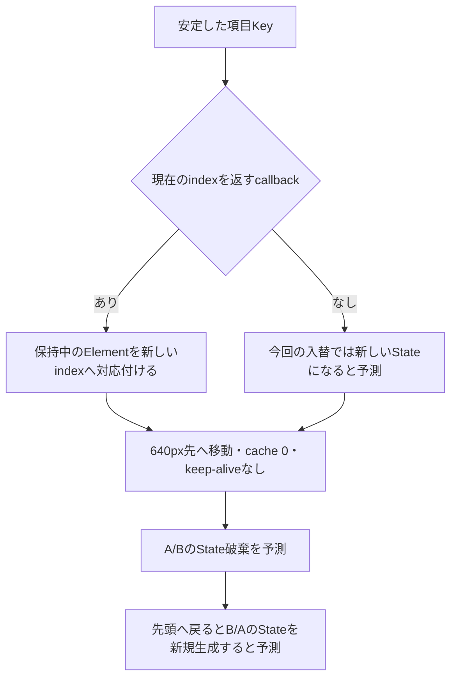

# ListViewの項目を入れ替えると、Stateはどこへ行くか

**制作状態：固定SDKで2条件×5段階の実Widget観測を局所受入し、保存実測readerのブラウザー操作・画像QAも確認しました。FlutterライブGUIのポインター・ドラッグは未確認です。**

2026-10-06 05:49:29〜05:49:32 UTC、Kotlinの実行枠解放後に実行しました。compile 2.961秒、tester 0.722秒、どちらもnice 10・exit 0。固定予測との差分0、FlutterError 0です。[実行記録](probe/observations/attempt-01/run.json)と[実Widget原票](probe/observations/attempt-01/actual.json)を保存し、別Pythonチェッカーの[163確認](verification/independent-observation-check.json)も通りました。図は説明図で、スクリーンショットではありません。初回の[静的確認](verification/text-check.json)は実行前の履歴として保持しています。

学習画面は、このディレクトリで`python3 serve.py`を実行し、`http://127.0.0.1:18751/`を開きます。GUI検証用の一時サーバーは終了済みです。readerは保存実測と実行ソースのhashを照合して表示し、Flutterを起動しません。

## 1. 要求と、前のColumn教材から進む境界

一覧を並べ替えても、編集中の各項目とそのStateを対応させたい。一方、長い一覧では全項目を常時生成したくありません。項目Keyを付けるだけで、この両方を満たせるでしょうか。

前のColumn教材では、同時に存在する直接の兄弟を比較しました。この単元は、必要なindexから子を作る`ListView.builder`で、**既存の子のKeyを現在のindexへ引き直す役割**を扱います。対象は「先頭2項目の入替」と「遠くへ移動して戻る」の有限なケースです。重複調査とゴール45への対応は[COVERAGE](COVERAGE.md)にあります。

## 2. 仕組みを分ける

項目Keyは「どの項目か」を表します。`findChildIndexCallback`は、そのKeyの項目が**現在の順序の何番目にあるか**を返します。固定SDKのdelegateは、この対応を使って既存Elementを新しいindexへ移します。callbackを省略した入替では、既存Stateとの対応が失われる可能性が公式ソースに明記されています。

画面外に離れて破棄されたStateは、indexを引けても復活しません。この単元ではcacheを0にし、AutomaticKeepAliveを付けず、子からもkeep-aliveを要求しません。業務データをStateの外で保存する設計や、keep-alive有効時の比較は次の範囲に残します。「見えなくなった瞬間、あらゆるListViewで必ず破棄される」という一般化はしません。



図は説明用です。以下の予測表は実行前に固定したもの、後半の実測表は別の原票から読み出したものです。

## 3. 操作前に予想する

同じ12項目A〜L、幅320px・高さ160px、項目高80px、padding 0、cache 0を使います。スクロール位置をPageStorageに保存しません。2条件の差はcallbackの有無だけです。どちらも`itemBuilder`が直接返す`CounterTile`に`ValueKey<String>(itemId)`を付けます。回数は各TileのStateが所有します。

1. 初期状態では、12項目のうち何が生成されると思いますか。
2. Aを1回、Bを2回増やしてからB/Aへ入れ替えると、項目・State・回数はどう対応しますか。
3. 640px先へ移動し、先頭へ戻ると、callbackありなら回数も戻るでしょうか。

予想を書いてから次の固定表を開いてください。表を実測として利用しないでください。

<details>
<summary>実行前に固定した予測表を表示</summary>

記法は`項目 : State記号 / 回数`です。`S_A`は「最初にAに生成されたState」という比較用記号で、実エンジンの採番値ではありません。R・F・Tはそれぞれ別の新規Stateを予測しています。生成・破棄イベントの細かな呼び出し順序は固定しません。

| 段階 | 操作 | callbackありの予測 | callbackなしの予測 |
| --- | --- | --- | --- |
| initial | offset 0で表示 | A:S_A/0、B:S_B/0 | A:S_A/0、B:S_B/0 |
| prepared | Aを1回、Bを2回増加 | A:S_A/1、B:S_B/2 | A:S_A/1、B:S_B/2 |
| reordered | 先頭2項目をB/Aに入替 | B:S_B/2、A:S_A/1 | B:R_B/0、A:R_A/0 |
| far | offset 640へ移動 | I:F_I/0、J:F_J/0 | I:F_I/0、J:F_J/0 |
| returned | offset 0へ戻る | B:T_B/0、A:T_A/0 | B:T_B/0、A:T_A/0 |

初期に生成されるindexが0と1だけ、という点も**実行前に固定したこのfixtureの予測**です。今回の原票とは一致しましたが、あらゆるListViewで2個になるという意味ではありません。境界のitemが追加生成される場合などは予測不一致として保存し、rendererの事実に合わせて黙って表を書き換えません。`itemBuilder`呼び出し回数と新しいStateの個数は別々に記録します。

| 段階 | callbackあり：新規 / 破棄の予測 | callbackなし：新規 / 破棄の予測 |
| --- | --- | --- |
| initial | S_A,S_B / なし | S_A,S_B / なし |
| prepared | なし / なし | なし / なし |
| reordered | なし / なし | R_B,R_A / S_A,S_B |
| far | F_I,F_J / S_A,S_B | F_I,F_J / R_B,R_A |
| returned | T_B,T_A / F_I,F_J | T_B,T_A / F_I,F_J |

機械可読版は[expectations.json](expectations.json)です。これは作成時点の事前予測を固定した入力で、`runtimeObserved: false`を含め変更していません。現在の実測状態は別の[原票](probe/observations/attempt-01/actual.json)で確認してください。

</details>

## 4. 操作・対照の手順

まず自分の予想を固定表と比べ、その後で保存原票を読んでください。実行条件と再現コマンドは[REPRODUCE](REPRODUCE.md)にあります。再実行する場合も、その時点の資源条件と担当間の実行枠を確認します。

プローブは、同じ操作列をcallbackあり・なしの各条件で行い、各段階で実Elementに存在するTile、表示Text、State識別子、回数、builder呼び出し、callback呼び出し、生成・破棄イベントを保存しました。先に原票を書き出し、その後で固定予測と照合します。

予測が外れても、可能な限り後続段階ともう一方の条件を観測します。差分・Flutterエラー・途中失敗を残し、失敗した試行を上書きしません。たとえば境界itemの追加生成は、項目対応の差分と生成数の差分を分けて読みます。

過去の実Widget操作はStateメソッドと`ScrollController.jumpTo`を直接呼ぶ方式です。現在のreaderで操作するのは、その保存観測の選択・再生です。FlutterライブGUIのポインターやドラッグを確認したことにはなりません。

readerでは「条件と予想を選ぶ → 入替後の保存実測を再生 → 同時点の対照と比較 → 原典・実行ソースを読む → 予想と実測を照合」の順に進みます。続けて「遠方へ」「先頭へ戻る」を選び、破棄後の再生成を比べます。条件変更・やり直しは予想も消し、予想変更は新しい予想を残して再生・対照・答えを消します。

2026-10-06の[reader自QA](ui-qa/run-2026-10-06T061122810Z/report.json)は、sandbox有効・専用profileの既存Chromiumで16確認・43ポインター操作・9実captureが成功しました。1280pxと390px、予想不一致、reset、成功後の503/digest不一致と回復、Abortを含む古い遅延応答の排除を確認しています。9枚を目視し、文字・数値・説明の欠けを認めませんでした。captureはreaderの実ブラウザー画面であり、Flutter描画画像ではありません。[目視記録](ui-qa/visual-review.json)と[reader受入記録](ui-qa/reader-acceptance.json)を参照してください。

## 5. 原典と実装を照合する

固定対象はFlutter 3.47.1 / Dart 3.13.1、framework revision `6655482ec06e547f90abf8ae7590466f4415978d`です。以下はそのrevisionへのリンクで、根拠の確認は既存ローカルSDKのテキスト読取で行いました。オンライン最新版・リンク到達性は今回検証していません。ファイルhashと読取範囲は[source-map.json](source-map.json)にあります。

| 調べる点 | 固定した公式ソース | 教材の実装 |
| --- | --- | --- |
| 子を必要に応じて作り、callbackをdelegateへ渡す | [ListView.builder](https://github.com/flutter/flutter/blob/6655482ec06e547f90abf8ae7590466f4415978d/packages/flutter/lib/src/widgets/scroll_view.dart#L1358-L1445) | [ListViewと固定fixture](probe/lib/listview_probe.dart) |
| 項目Keyから新indexを返す。見つからなければnull | [SliverChildBuilderDelegate](https://github.com/flutter/flutter/blob/6655482ec06e547f90abf8ae7590466f4415978d/packages/flutter/lib/src/widgets/scroll_delegate.dart#L517-L575) | 同ファイルの`indexFor` |
| 既存Elementを新indexへ対応付ける | [SliverMultiBoxAdaptorElement.performRebuild](https://github.com/flutter/flutter/blob/6655482ec06e547f90abf8ae7590466f4415978d/packages/flutter/lib/src/widgets/sliver.dart#L969-L1053) | `withLookup`と`withoutLookup`の対照 |
| 子の破棄と、データ所有を外へ移す選択 | [ListViewのchild lifecycle](https://github.com/flutter/flutter/blob/6655482ec06e547f90abf8ae7590466f4415978d/packages/flutter/lib/src/widgets/scroll_view.dart#L1090-L1130) | `far`と`returned` |

短い対応付けの核は次の通りです。観測用ログを省いた実装の抜粋です。

```dart
int? indexFor(Key key) {
  final item = key is ValueKey<String> ? key.value : null;
  final index = item == null ? -1 : order.indexOf(item);
  return index < 0 ? null : index;
}
// orderの入替後も、この関数は現在のorderを参照する。
// itemBuilderはCounterTile(key: ValueKey<String>(order[index]), ...)を返す。
```

小さい12項目のため`indexOf`で対応を示しています。大量項目へそのまま適用する性能判断は本教材では行っていません。実務でID→index表を用意する場合も、順序変更時に更新し、重複ID・削除済みIDを正しく扱う必要があります。

## 6. 答え合わせと実務判断

実Widgetの保存原票では次を観測しました。表の`S1`などは条件ごとに採番された実識別子です。別条件間で同じ`S1`が出ても同一オブジェクトではありません。記法は`項目 : 実State ID / 回数`です。

| 段階 | callbackありの実測 | callbackなしの実測 |
| --- | --- | --- |
| initial | A:S1/0、B:S2/0 | A:S1/0、B:S2/0 |
| prepared | A:S1/1、B:S2/2 | A:S1/1、B:S2/2 |
| reordered | B:S2/2、A:S1/1 | B:S3/0、A:S4/0 |
| far | I:S3/0、J:S4/0 | I:S5/0、J:S6/0 |
| returned | B:S5/0、A:S6/0 | B:S7/0、A:S8/0 |

初期のbuilder呼出indexは0/1、遠方は8/9でした。どの段階でも実RenderBoxは幅320・高さ80、上端0/80でした。これはこの固定fixtureの測定値であり、画像の目視確認ではありません。終了時は両条件とも残存Stateが0、起動したcompiler/testerの記録済みPIDも残っていません。Stateが失われる対照条件は意図した教材条件で、Flutter例外が発生したという意味ではありません。

別Pythonチェッカーはproducerの`passed`や予測行を使わず、原票からState同一性、イベントによる生存集合、回数、実Element Text、geometry、cleanupと入力hashを再照合しました。同一作者による独立した実装であり、別人のレビューではありません。

| 判断したいこと | この単元から立てる判断 | まだ証明していないこと |
| --- | --- | --- |
| 入替後も保持中の項目Stateを対応させたい | 安定IDのKeyと、現在の順序を返すcallbackを組にする | あらゆるSliver構成・任意の入替パターン |
| 長い一覧の回数や入力データを失いたくない | 業務データの所有者を子Stateの外に置く設計を検討する | 外部保存・復元・永続化の実装 |
| 画面外の子State自体を残したい | cacheとkeep-alive条件を別途設計・測定する | keep-alive有効時、メモリー量・性能 |
| 生成数が予想と違った | geometry、cache、境界item、生成と再buildの違いを原票で調べる | 予測を観測に置き換えること |

## 7. 受入条件と残る範囲

静的確認とは別に、固定SDK・資源条件を満たした1回の短い逐次batchで、2条件×5段階の原票と差分、優先度設定、入力hash、終了時のState破棄を確認しました。[局所受入記録](verification/widget-acceptance.json)に対象と制限を記録しています。固定予測と実装ロジックの変更・再compileはありません。実行前説明からの変更履歴は[文書修正記録](document-revisions/2026-10-06-widget-acceptance/revision.json)に保存しました。

FlutterライブGUI・ポインター/ドラッグ、keep-alive比較、削除/挿入、任意位置への移動、外部モデルへの保存、GlobalKey、復元、可変高さ、複数Sliverは未対応です。Flutter全体・ゴール45全体の完了を示す教材ではありません。再利用手順は[SKILL](SKILL.md)にあります。
