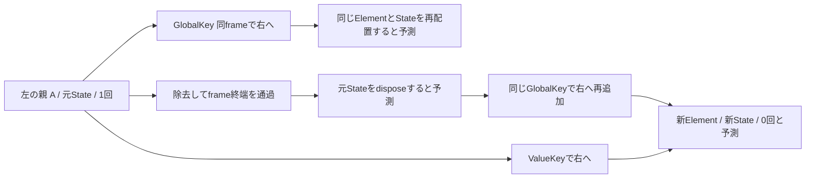

# 親を移るStateは、いつまで同じか

**状態：固定SDKの3条件×4時点の実Widget検証と、保存実測readerのGUI・画像QAが成功しました。別担当の最終受入は[現在の受入記録](ui-qa/reader-acceptance.json)で確認できます。FlutterライブGUI/pointer/drag・Flutter描画画像は未確認です。**

## 学習画面を開く

このディレクトリで`python3 serve.py`を実行し、`http://127.0.0.1:18754/`を開きます。入口は[index.html](index.html)です。終了時はCtrl+Cで自分のサーバーを止めます。SDKや外部サービスの起動は不要です。

画面操作は保存した実Widget原票の選択・再生です。Flutterをライブ再実行しません。左右の親とカードは原票の関係を表したDOMで、実Flutterの描画画像ではありません。原票と実行時ソースのdigestが一致しない場合は再生しません。

1. GlobalKeyの同frame移動・一度除去・ValueKey移動から条件を選び、右に置いた後のState/Element/回数を予想する。
2. 「移動・除去の保存実測を再生」でtransitionを確認する。残る2条件の同じ列も比較し、操作の違いを読む。
3. 「右に置いた後」を選び、親Slot・直親Element・子Element・Stateを分けて見る。
4. 原典と実行時ソースを読み、「予想と実測を照合」する。答え合わせは右に置いた後の時点で行う。

予想変更は新しい予想だけを残して準備時点へ戻り、条件変更・やり直しは予想も消します。古い再生・対照・答えは消えます。取得失敗やdigest不一致では古い行・答え・ソースを表示せず、旧応答の遅着でも後の結果を上書きしません。

## 要求

左の親の下にあるカウンターAを右の親へ移したい。1回増やした値と同じStateを使えるのは、どの移し方でしょうか。GlobalKeyが同じなら、treeから一度なくなった後も元に戻るのでしょうか。

この単元はゴール45のWidget・Element・State・Keyの同一性と、削除後に何を保存すべきかを扱います。直前のListView/keep-aliveは兄弟の入替や画面外の保持です。今回はスクロールをなくし、別parentへの移動とframe終端の境界だけを比べます。

## 仕組みと予想

固定SDKのGlobalKey契約では、別の位置へ同じframeで挿し直すとElement subtreeとStateを引き継げます。`deactivate`は終わりとは限らず、再挿入時の`activate`と永久除去の`dispose`を区別します。GlobalKeyオブジェクトはHostStateで一度だけ作り、buildのたびに作り直しません。同じKeyを二箇所へ同時に置きません。



図は説明モデルです。実Flutter画像でも観測トレースでもありません。

左右の親を固定し、子はAだけ、幅400・高さ160、各親の幅200とします。回数を持つのはTileStateだけです。外部モデル・保存・restoration・keep-aliveは使いません。

まず「右へ移った後のStateと回数」「deactivateの後にactivateかdisposeのどちらが来るか」を予想してください。`S`は元State、`T`は新Stateを表す記号です。実際の採番は指定しません。

| 条件 | initial | prepared | transition | atRight |
| --- | --- | --- | --- | --- |
| GlobalKey・同frame移動 | 左S/0 | 左S/1 | 右S/1、deactivate→activate | 右S/1 |
| GlobalKey・一度除去 | 左S/0 | 左S/1 | Aなし、deactivate→dispose。frame終了まで待つ | 右T/0、initState |
| ValueKey・同frame移動 | 左S/0 | 左S/1 | 右T/0、Sをdispose・TをinitState | 右T/0 |

全体のcallback順序は固定しません。ValueKey条件の新規生成と旧State破棄の前後関係も採点対象にしません。State/Elementの同一性、親の移動、回数と各イベントの集合を照合します。[固定予測JSON](expectations.json)は実行前入力として保持し、結果で上書きしません。

## 操作と正常・不一致の比較

[プローブ](probe/lib/reparent_probe.dart)はHostStateを操作して初期→1回増加→移動/除去→右側の4時点を記録します。GlobalKeyの同frame条件は1回のsetStateで左右を切り替えます。一度除去する条件は空のtreeでframe終了を待ち、それから再追加します。除去と追加を同じsetStateにまとめません。

実Element treeから親Slot・直親Element・Tile Element・State・Textを読み、同一オブジェクトに割り当てたIDで比較します。生存registry、GlobalKey.currentState、initState/deactivate/activate/disposeも原票へ保存します。推測したStateを原票へ埋めません。原票を比較より先に保存し、予想不一致やFlutterErrorも残します。

2026-10-06に実行枠とfresh資源判定を確認し、[短いbatch](probe/observations/attempt-01/run.json)を1回実行しました。compile2.258秒・tester0.771秒、両nice10・exit0、retry0です。native原票はStateメソッドによるWidget実験です。その後のreader QAでは実ポインター操作と実Chromium captureを確認しました。両者をFlutterライブGUI操作と混同しません。新たなnative観測が必要な場合は[再現手順](REPRODUCE.md)を使います。

## 固定原典と実装

Flutter 3.47.1 / Dart 3.13.1、framework revision `6655482ec06e547f90abf8ae7590466f4415978d`の保存済みSDKを読みました。オンライン最新版の照合ではありません。範囲とdigestは[source-map.json](source-map.json)です。

- [GlobalKeyの契約と所有期間](https://github.com/flutter/flutter/blob/6655482ec06e547f90abf8ae7590466f4415978d/packages/flutter/lib/src/widgets/framework.dart#L115-L150)：同frame再配置・同時重複禁止・長寿命の所有。
- [deactivateとactivate](https://github.com/flutter/flutter/blob/6655482ec06e547f90abf8ae7590466f4415978d/packages/flutter/lib/src/widgets/framework.dart#L1230-L1292)：移動でdeactivateが呼ばれてもdisposeとは限らない。
- [frame終端のfinalizeTree](https://github.com/flutter/flutter/blob/6655482ec06e547f90abf8ae7590466f4415978d/packages/flutter/lib/src/widgets/framework.dart#L3352-L3360)：inactiveのままのElementをunmountする。
- [既存Elementの取得と新規生成の分岐](https://github.com/flutter/flutter/blob/6655482ec06e547f90abf8ae7590466f4415978d/packages/flutter/lib/src/widgets/framework.dart#L4580-L4607)：GlobalKeyの再取得を試し、なければ新規Elementを作る。

```dart
// HostStateが所有し、build内で作り直さない。
final movingKey = GlobalKey<TileState>();
// 同frame移動：1回の更新で左を空にし、右へ同じKeyのTileを置く。
setState(() { location = 'right'; });
// 別条件ではlocation=nullでframe終了を待ち、それから右へ追加する。
```

## 答えを照合して判断する

[実Widget原票](probe/observations/attempt-01/actual.json)では次の対応でした。IDは条件ごとの採番なので、異なる条件の同じS1/E2は同じオブジェクトではありません。初期は左S1/E2/0、準備後は左S1/E2/1です。

| 条件 | transitionの実測 | atRightの実測 |
| --- | --- | --- |
| GlobalKey・同frame移動 | 右S1/E2/1。直親ElementはE3→E5、deactivate→activate | 右S1/E2/1のまま |
| GlobalKey・一度除去 | Aなし、S1をdispose、GlobalKey.currentStateはnull | 右S2/E5/0を新規生成 |
| ValueKey・同frame移動 | 右S2/E5/0を新規生成、S1をdispose | 右S2/E5/0のまま |

左右の親Slotは全段階で同じElementです。GlobalKeyの同frame移動では、直親が変わってもTile ElementとStateが同じでした。一度除去した条件は同じGlobalKeyオブジェクトを使っていますが、破棄したStateは戻りませんでした。全条件のcleanupで、生成したすべてのStateをdisposeしています。

[別Python照合](verification/independent-observation-check.json)はproducerのpassed・symbols・expectedを正解として使わず、原票イベントから生存と回数を再構成し245確認が通りました。これは作者が別ロジックで行った照合で、別担当による受入ではありません。事前予測・runtime入力は変更せず、実行時snapshotとdigestを保持しています。自分のcompiler/testerの[記録済みPIDは残存0](verification/process-cleanup-attempt-01.json)でした。

実務では、同じtree内での再配置と、削除後にデータを取り戻す仕組みを分けます。Keyは永続保存ではありません。必要な業務データを子Stateだけに持たせてよいか、親や外部モデルへ移すべきかを判断します。

## readerの受入記録

[GUI原票](ui-qa/run-2026-10-06T071105414Z/report.json)は17確認・60実ポインター操作・13実captureで成功しました。3条件×4時点のState/Element/直親/親Slot/回数、残る2条件の対照、GlobalKey.currentStateとイベント列を保存原票と照合しました。1280/390pxで文字・関係表示・答え・失敗画面を[目視確認](ui-qa/visual-review.json)しています。取得失敗とdigest不一致はブラウザー応答への注入で、native原票は不変です。遅延ケースはAbortを含む実経路であり、世代番号ガード単独の試験ではありません。

browser・専用profile・一時サーバーは終了済みです。変更前文書、UI初期snapshot、差分と対象hashは[修正記録](document-revisions/2026-10-06-reader-ui/revision.json)へ保存します。native段階の[検証記録](verification/status.json)のGUI未実施は当時の履歴として保持し、現在のreader受入は別記録にします。GUI制作に伴うnative再実行はありません。

## 限界

同一Widget型の子1つ、固定された2親だけです。GlobalKey重複例外、型変更、InheritedWidgetの依存再構築、reparentの費用、Route/Overlay、process復元、外部保存、FlutterライブGUI/pointer/drag・Flutter描画画像は別範囲です。受入済みのColumn/ListView/keep-alive原票・文書は変更しません。[COVERAGE](COVERAGE.md)と[案内Skill](SKILL.md)に境界を残します。
