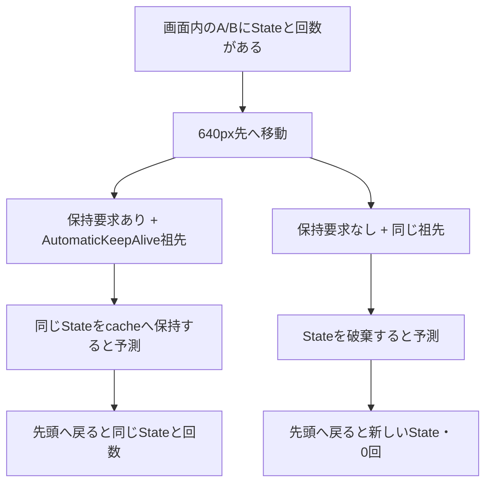

# 画面の外で、そのStateは生きているか

**状態：固定SDKの2条件×4段階の実Widget観測と、保存実測リーダーのGUI・画像QAが成功しました。別担当の最終受入は[現在の受入記録](ui-qa/reader-acceptance.json)で確認できます。FlutterライブGUIのpointer/dragやFlutter描画画像は未確認です。**

2026-10-06の[実行記録](probe/observations/attempt-01/run.json)はcompile 3.067秒・tester 0.677秒、両方nice 10・exit 0です。[実Widget原票](probe/observations/attempt-01/actual.json)と[別実装の照合](verification/independent-observation-check.json)を保存しました。今回の追加nativeは1 batchだけです。事前の[静的確認](verification/static-check.json)や入力ソース先頭の制作時注記は当時の履歴として保持します。

ListView教材では、cache 0・keep-aliveなしで遠くへ移動するとStateが破棄され、戻っても回数が復元されませんでした。この単元では、画面外の子から保持を要求した場合に何が変わるかを、1つの境界だけで比べます。前教材の原票・画像・受入済み文書は変更しません。

## 学習画面を開く

このディレクトリで`python3 serve.py`を実行し、`http://127.0.0.1:18753/`を開きます。入口は[index.html](index.html)です。終了時はサーバーをCtrl+Cで止めます。SDKや外部サービスは不要です。

GUI操作は、過去の実Widget原票を選択・再生する操作です。Flutterをライブ再実行するものではありません。カードは原票をlayout/cachedに分類した表示で、Flutterの描画画像ではありません。原票と実行時ソースのdigestが一致しなければ再生しません。

1. 子の保持要求と、先頭へ戻ったときのState・回数の予想を選ぶ。
2. 「遠方の保存実測を再生」で、layoutのI/JとcachedのA/B、生存数を対照条件と比較する。
3. 「先頭へ戻る」を選び、A/Bの同一性と回数、cachedに残るI/Jを確認する。
4. 固定公式ソースと実行時のWidgetソースを読み、「予想と実測を照合」する。答え合わせは戻った時点で行う。

予想変更は新しい予想だけを残して準備時点へ戻し、条件変更・やり直しは予想も消します。どちらも前の再生・対照・答えを消します。取得失敗やdigest不一致では古い行・答え・ソースを表示せず、遅れて届く旧応答でも新しい結果を上書きしません。

## 要求と仕組み

編集中のAとBをいったん画面外へ移し、戻ったときも同じStateと回数を使いたい。ListViewの`addAutomaticKeepAlives: true`だけで、すべての子が常に保持されるのでしょうか。

この設定は、子の保持要求を受ける`AutomaticKeepAlive`を挿入します。`AutomaticKeepAliveClientMixin`側の`wantKeepAlive`が要求を表し、`super.build(context)`との契約も必要です。要求がある子は画面外でcacheへ保持され得ます。要求がない子との比較を、同じレイアウト条件で行います。



図は事前に立てた説明モデルです。実Flutterの画像ではありません。後述の実測表とは区別します。cacheへ保持中のStateを「現在画面に表示中」と呼ばないことも、この単元の観察点です。

## 先に予想する

両条件とも、12項目A〜L、viewport幅320・高さ160、項目高80、padding 0、scroll cache 0、`addAutomaticKeepAlives: true`です。項目Keyも同じです。順序は変えません。違いは子の`wantKeepAlive`が常にtrueか、常にfalseかだけです。各子の回数はそのStateが持ち、外部へ保存しません。

1. Aを1回、Bを2回増やしてから640px先へ移すと、A/BのStateは破棄されるでしょうか。
2. 画面に見えるI/J以外に、生存中のStateはありますか。
3. 先頭へ戻るとA/BのState識別子と回数はどうなりますか。

<details><summary>実行前の固定予測を開く</summary>

以下は実行前に固定した予測です。`S_A`などはStateの同一性を比較する記号で、実際の採番順を指定しません。`layout`はSliverの保持cacheに入っていない子、`cached`は公開parent dataの`keptAlive`がtrueの子を指します。このfixtureではlayoutの2項目がviewport内に収まると予測しましたが、一般の可視性判定には拡張しません。

| 段階 | 操作 | 保持要求あり：生存Stateの予測 | 保持要求なし：生存Stateの予測 |
| --- | --- | --- | --- |
| initial | offset 0 | A:S_A/0、B:S_B/0（layout） | A:S_A/0、B:S_B/0（layout） |
| prepared | Aを1回、Bを2回増加 | A:S_A/1、B:S_B/2（layout） | A:S_A/1、B:S_B/2（layout） |
| far | offset 640 | A:S_A/1、B:S_B/2（cached）、I:S_I/0、J:S_J/0（layout） | A/B破棄。I:S_I/0、J:S_J/0（layout） |
| returned | offset 0 | A:S_A/1、B:S_B/2（layout）、I:S_I/0、J:S_J/0（cached） | I/J破棄。A:T_A/0、B:T_B/0（layout） |

要求ありでは、戻った後にもI/Jが保持され、合計4 Stateが生存すると予測しています。「画面内2行」と「生存State 4個」は同じ数ではありません。予測が外れた場合も原票を保存し、境界itemや保持処理の観測を捨てません。機械可読表は[expectations.json](expectations.json)です。作成時の`runtimeObserved:false`を含め事前予測は凍結しており、現在の実測状態は別の原票で確認します。

</details>

## 操作・対照の手順

実行枠調整と直前の全体資源確認後に、2条件×4段階を1回の短いbatchで観測しました。まず予測を決めてから、[保存原票](probe/observations/attempt-01/actual.json)の各段階を比較してください。必要時の再実行は[再現手順](REPRODUCE.md)を参照し、SDKのinstallや更新は行いません。

プローブは、実Element treeにあるすべてのTile Stateと、生存registry、表示Text、回数、生成・破棄イベントを記録します。TileのRenderObjectからSliver用の公開parent dataへ辿り、`keepAlive`（保持要求）と`keptAlive`（cacheへ保持中）を分けて読みます。privateなcache構造を変更しません。原票を保存してから固定表を照合し、不一致でも可能な限り後続段階を記録します。

native原票はStateメソッドと`ScrollController.jumpTo`による操作です。その後、保存実測readerの実ポインター操作と実Chromium captureを別に確認しました。このreader QAはFlutterライブGUIのドラッグやFlutter描画の確認を済ませたことにはなりません。

## 原典と実装

保存済みFlutter 3.47.1 / Dart 3.13.1、framework revision `6655482ec06e547f90abf8ae7590466f4415978d`のローカルソースを読んでいます。オンライン最新版の照合ではありません。読取範囲とhashは[source-map.json](source-map.json)にあります。

| 読む点 | 固定公式ソース | 今回の実装 |
| --- | --- | --- |
| 要求の通知とbuild契約 | [AutomaticKeepAliveClientMixin](https://github.com/flutter/flutter/blob/6655482ec06e547f90abf8ae7590466f4415978d/packages/flutter/lib/src/widgets/automatic_keep_alive.dart#L374-L490) | [TileState](probe/lib/keepalive_probe.dart)のwantKeepAliveとsuper.build |
| 祖先wrapperの挿入 | [SliverChildBuilderDelegate](https://github.com/flutter/flutter/blob/6655482ec06e547f90abf8ae7590466f4415978d/packages/flutter/lib/src/widgets/scroll_delegate.dart#L544-L575) | 両条件ともaddAutomaticKeepAlives:true |
| 保持中のpublic parent data | [SliverMultiBoxAdaptorParentData](https://github.com/flutter/flutter/blob/6655482ec06e547f90abf8ae7590466f4415978d/packages/flutter/lib/src/rendering/sliver_multi_box_adaptor.dart#L163-L175) | [観測プログラム](probe/test/native_probe.dart)のkeepAlive/keptAlive |
| 画面外の子をcacheへ移すか破棄するか | [destroy/cacheとgarbage処理](https://github.com/flutter/flutter/blob/6655482ec06e547f90abf8ae7590466f4415978d/packages/flutter/lib/src/rendering/sliver_multi_box_adaptor.dart#L373-L386) | far/returnedのState同一性・dispose対照 |

```dart
class TileState extends State<Tile>
    with AutomaticKeepAliveClientMixin<Tile> {
  @override
  bool get wantKeepAlive => widget.keep; // 本実験中は一定
  @override
  Widget build(BuildContext context) {
    super.build(context); // 戻り値を使わず、必ず呼ぶ
    return Text('子Stateが持つ回数を表示');
  }
}
```

将来`wantKeepAlive`を変更するなら、変化時の`updateKeepAlive()`が必要という契約があります。本単元の値は一定なので動的切替を実験済みにはしません。

## 答え合わせと実務判断

実測では次の対応になりました。State IDは条件ごとの採番です。別条件の同じS1は別オブジェクトです。記法は`項目:State ID/回数`です。

| 段階 | 保持要求ありの実測 | 保持要求なしの実測 |
| --- | --- | --- |
| initial | layout A:S1/0、B:S2/0 | layout A:S1/0、B:S2/0 |
| prepared | layout A:S1/1、B:S2/2 | layout A:S1/1、B:S2/2 |
| far | cached A:S1/1、B:S2/2 ＋ layout I:S3/0、J:S4/0 | A/B破棄。layout I:S3/0、J:S4/0 |
| returned | layout A:S1/1、B:S2/2 ＋ cached I:S3/0、J:S4/0 | I/J破棄。layout A:S5/0、B:S6/0 |

要求ありのfar/returnedは生存Stateが4個、うちcachedが2個でした。要求なしは各時点で2個でした。`keptAlive`の読取で保持区分を確認し、終了時は両条件とも全Stateを破棄しています。同じStateを保持できたのは同じtree内での生存であり、process終了後の復元や永続化ではありません。cachedのTextはElement subtreeからの読取で、画面に描かれた証拠ではありません。

| 判断 | この単元で分けること |
| --- | --- |
| 画面外でも一時的なUI状態を保ちたい | 子の保持要求と、それを受ける祖先の条件を確認する |
| 全項目を保持すべきか | 保持する子が増える設計上の費用を考える。ここではメモリー/性能の優劣を測定しない |
| 業務データを失いたくない | 子の生存保持と、外部モデル・永続保存を分ける |
| 値は同じなのに仕組みが違う | 表示中とcached、生存Stateと新規Stateを原票で区別する |

## 受入と残る範囲

固定2条件×4段階、生成/破棄、全生存Stateとcache区分、実Text、終了時cleanupが一致しました。別Python実装はproducerのpassedや固定期待行に依存せず191関係を照合しています。別人によるレビューではありません。[Widget検証結果](verification/widget-result.json)に対象と限界を記録しました。事前予測・実装ロジックの変更や再compileはありません。

保存実測readerは[GUI原票](ui-qa/run-2026-10-06T064226909Z/report.json)の16確認・51実ポインター操作・11実captureで成功しました。2条件×4時点の全行、layout/cached別の件数、生存数4/2を原票と照合し、1280/390pxの画像を[目視確認](ui-qa/visual-review.json)しています。失敗・旧遅延応答の検査はブラウザー応答に限った操作で、native原票は不変です。専用profile・browser・一時サーバーは終了済みです。変更前文書と差分は[修正記録](document-revisions/2026-10-06-reader-ui/revision.json)に保存します。

reorder、動的な保持要求の変更、GlobalKey、外部復元、可変高さ、Page/Tab、OS lifecycle、メモリー性能、FlutterライブGUI/pointer/drag・Flutter描画画像は未対応です。案内手順は[SKILL](SKILL.md)、対応範囲は[COVERAGE](COVERAGE.md)にあります。
